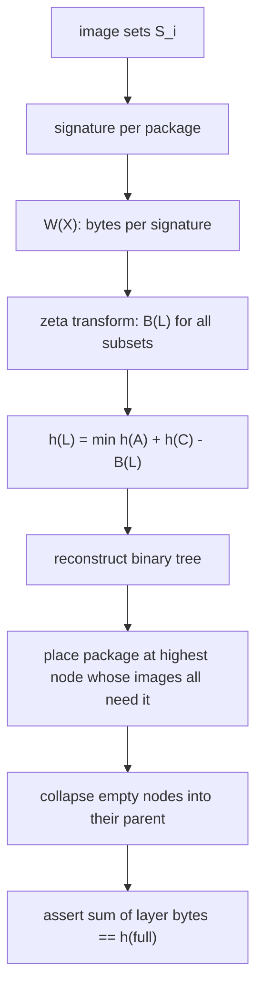
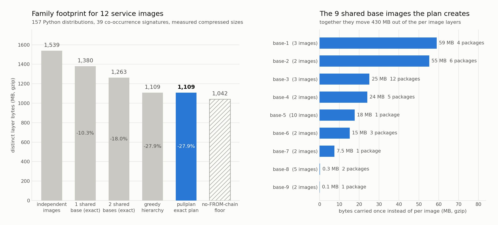

# pullplan

Synthesise the provably cheapest base image hierarchy for a family of container images, and emit the Dockerfiles that build it.

## The problem

A team ships twelve Python services. Each one gets the same treatment: `FROM python:3.13-slim`, `RUN pip install -r requirements.txt`, push. Every image ends up carrying its own private copy of numpy, its own copy of pandas, its own copy of whatever else it shares with its neighbours. The registry stores those copies, a node that runs several of the services pulls them again per image, and nobody notices because each image looks reasonable on its own.

The usual advice is "use a shared base image". That advice stops exactly where it gets hard. Which packages go in the base? What if one service does not want numpy, so numpy cannot live in a base that service inherits from? Should there be one base, or three, or nine, and which services should each one serve? Those are not style questions. They have a numeric answer, and nothing in the Docker toolchain computes it: `docker build` optimises one image at a time, and BuildKit cache reuse is about rebuilds, not about what a *family* of images stores and transfers.

## What this does

`pullplan` reads the Python distributions installed on a host, resolves each service to its real dependency closure, measures what each package actually costs as a compressed layer (tar framing included, gzip at the level a registry uses), and then solves for the base image hierarchy that minimises the family's total distinct layer bytes. It prints the comparison against what you ship today, writes the Dockerfiles for every base image and every leaf, and checks its own answer: the layers it emits are re-summed and compared against the number the optimiser claimed.

It also answers the budgeted question exactly, because "how many base images am I willing to maintain" is the question teams actually ask:

- the best plan with exactly one shared base
- the best plan with two
- the unrestricted optimum
- the floor a non-Dockerfile builder could reach, so you can see what the `FROM` chain itself costs you

## Why it is interesting

The structure of the problem is what makes it solvable rather than just searchable.

A layer shared by a set of images `T` can only contain packages that *every* image in `T` needs, so a layer's content is bounded by an intersection. Write `B(L)` for the total compressed size of the packages needed by every image in `L`. A Dockerfile build graph cannot express an arbitrary assignment of layers to images: an image inherits the layers on its `FROM` chain, so the image sets that share a layer are nested or disjoint, never crossing. The admissible plans are exactly the laminar families over the images, which is to say the hierarchies.

Two observations then collapse the search:

1. A layer placed at a node with `k` children saves `(k - 1) * B(L)` bytes, and a `k`-ary node never saves more than a binary cascade over the same leaves. So binary hierarchies contain an optimum.
2. That gives a recurrence over subsets, solved exactly:

```
h(L)   = min over bipartitions (A, C) of L:  h(A) + h(C) - B(L)
h({i}) = B({i}) = the footprint of image i on its own
```

`B` itself is the superset sum (zeta transform) of the signature weights, computed in `O(2^N * N)`; the recurrence is `O(3^N)` by enumerating each subset's bipartitions. For twelve images that is 531441 bipartitions, and it runs in 0.08 seconds. The tests verify the dynamic program against exhaustive enumeration of *every* hierarchy, k-ary ones included, for families up to six images.

The honest part of the result is worth stating plainly: greedy agglomerative merging is a very good heuristic here. Over 200 random nine image families drawn from the same host, greedy missed the optimum 15 times, and when it missed, it missed by 0.24 percent on average and 0.61 percent at worst (`scripts/greedy_gap.py`). The exact solver earns its place by certifying the answer and by solving the budgeted variants, not by beating greedy by a wide margin. What beats the status quo by a wide margin is doing any of this at all.

## Architecture

FigJam board: https://www.figma.com/board/mCglBGoCUC85Ui16FKVMCg

The diagram shows the pipeline from installed packages to emitted Dockerfiles: closure resolution and size measurement feed a signature indexed instance, the zeta transform produces the intersection weights the optimiser needs, the subset dynamic program returns the exact hierarchy, and the reconstructed tree is re-measured before anything is written.

Code level flow of the solve itself:



## Results



The metric is the family's **distinct layer bytes**: the compressed bytes a registry stores for the whole family, and the bytes a node pulls to run all twelve services. The baseline is how these images are built today, each one self contained, which costs 1539.4 MB. The exact hierarchy costs 1109.2 MB, a 27.9 percent reduction, achieved by nine shared base images that between them move 430 MB out of the per image layers.

The two intermediate bars are the interesting ones. The best *single* shared base, chosen optimally rather than by hand, recovers only 10.3 percent: it has to leave out anything that is not wanted by every image it serves, and in this family `db-worker` wants none of the scientific stack, which alone rules numpy out of any base serving all twelve. Two bases get to 18.0 percent. The remaining ten points only arrive once the plan is allowed to be a real hierarchy, with `scipy` and `scikit-learn` pooled for the three classic ML services, `pyarrow` and `pandas` pooled for the two data services, and `numpy` sitting above all ten services that want it.

The right hand panel shows where the saving comes from, and it is not evenly spread: two base images account for 114 MB of the 430 MB, and the base serving the most images carries a single package.

The last bar is a floor, not a plan. 1042.1 MB is what you could reach if layers were assigned to images freely instead of through `FROM` chains, which is what content addressed builders such as Bazel and ko can do. The gap between 1109.2 and 1042.1 is the price of the Dockerfile build model itself: 6.4 percent, measured rather than assumed.

Sizes are measured, not declared. Every file of every distribution is read, framed the way tar frames it (512 byte header, content padded to a 512 byte boundary), and compressed with zlib at level 6. Distributions larger than a 16 MB sample cap are measured on a deterministic prefix of their file list and extrapolated by the observed ratio, which is recorded per package in `data/dist_sizes.json`. Measuring the 157 distributions in this family took 237 seconds.

Across 200 random nine image families from the same host, the exact plan saved 22.0 percent on average, from 0.67 percent on a family with nothing in common up to 62.9 percent on one with a heavy shared core.

## How to run it

```bash
pip install -r requirements.txt

# 1. measure the distributions this host has installed (about four minutes for the demo family)
python scripts/measure_sizes.py

# 2. solve the family, write the plan, render the chart
python demo.py

# 3. the correctness suite: the DP against exhaustive enumeration
python -m pytest tests -q
```

The shipped `data/dist_sizes.json` is a real measurement from one machine, so step 2 works immediately after cloning; re-run step 1 to measure your own host.

Point it at your own services with a JSON file mapping image name to the packages it imports:

```bash
cat > my_family.json <<'EOF'
{
  "api":     ["fastapi", "uvicorn", "httpx"],
  "trainer": ["scikit-learn", "pandas"],
  "scorer":  ["onnxruntime", "numpy"]
}
EOF

python -m pullplan measure --family my_family.json
python -m pullplan plan --family my_family.json --out plan_out
python -m pullplan plan --family my_family.json --bases 1   # the best single shared base
```

The solver is `O(3^N)` in the number of images, which is instant to about 14 images and tolerable to 18.

## Example outputs

The strategy table from `python demo.py` on the twelve service family:

```
strategy                              footprint    saved
independent images                      1539.4 MB     0.0%
1 shared base (exact)                   1380.4 MB    10.3%
2 shared bases (exact)                  1262.5 MB    18.0%
greedy hierarchy                        1109.2 MB    27.9%
pullplan exact plan                     1109.2 MB    27.9%
no-FROM-chain floor                     1042.1 MB    32.3%
```

The hierarchy it found, where every node is a real image and the indentation is the `FROM` chain:

```
python:3.13-slim [12 images] carries 0.0 MB in 0 packages
  base-9 [2 images] carries 0.1 MB in 1 package
    llm-api-gateway [image] carries 7.2 MB
    db-worker [image] carries 22.1 MB
  base-5 [10 images] carries 17.7 MB in 1 package
    base-8 [5 images] carries 0.3 MB in 2 packages
      base-3 [3 images] carries 25.1 MB in 12 packages
        embedding-service [image] carries 180.1 MB
        base-6 [2 images] carries 15.2 MB in 3 packages
          vector-search [image] carries 43.8 MB
          onnx-inference [image] carries 0.0 MB
      base-7 [2 images] carries 7.5 MB in 1 package
        vision-preproc [image] carries 44.6 MB
        tf-batch-scorer [image] carries 454.0 MB
    base-1 [3 images] carries 59.0 MB in 4 packages
      audio-feature [image] carries 50.5 MB
      base-4 [2 images] carries 24.0 MB in 5 packages
        tabular-train [image] carries 0.0 MB
        nlp-classic [image] carries 5.1 MB
    base-2 [2 images] carries 55.2 MB in 6 packages
      analytics-dash [image] carries 43.9 MB
      etl-arrow [image] carries 53.8 MB
```

`onnx-inference` and `tabular-train` carry nothing of their own: everything they need is already on their inherited chain. That falls out of the optimisation rather than being arranged.

One of the 21 Dockerfiles it writes:

```dockerfile
# base-1
# shared by: audio-feature, tabular-train, nlp-classic
# layer content: 4 packages, 59.0 MB compressed
FROM base-5
RUN pip install --no-cache-dir \
        joblib \
        scikit-learn \
        scipy \
        threadpoolctl
```

Alongside them, `plan_out/` gets `hierarchy.txt`, `hierarchy.mmd` (the same tree as a Mermaid graph), and `layers.csv` with one row per layer.

## Layout

```
pullplan/corpus.py   dependency closures and measured tar plus gzip sizes
pullplan/plan.py     zeta transform, the subset DP, baselines, tree reconstruction
pullplan/emit.py     Dockerfiles, ASCII tree, Mermaid, layers.csv
pullplan/cli.py      python -m pullplan measure | plan
demo.py              solves the shipped family and writes docs/results.json
make_chart.py        renders docs/before_after.png from those results
scripts/             size measurement and the greedy versus optimal experiment
tests/               the DP against exhaustive enumeration
```

## Licence

MIT
